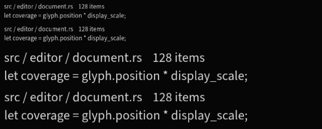
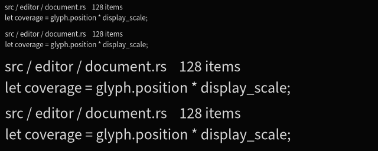

# Coverage placement comparison

Captured on Axiom, macOS, Apple M5 Max, wgpu Metal, 2026-10-15. Both images
come from actual offscreen GPU readbacks using the bundled Source Sans 3 Regular
font at 13 logical pixels, 18-pixel line height, identical colors, placement,
hinting, linear atlas filtering and 1× MSAA. The framebuffer is linear RGBA8;
conversion to PNG preserves the readback bytes without a color profile. These
images isolate sampling/placement rather than matching a macOS application's
full color-management pipeline. No timing or benchmark run was performed.

| Row | Raster/draw scale | Final physical origin |
| --- | --- | --- |
| 1 | 1× | (8, 4) |
| 2 | 1× | (8.375, 48.625) |
| 3 | 2× | (8, 96) |
| 4 | 2× | (8.375, 174.625) |

Before (the unchanged default path, equivalent to main before this fix):



After (`TextRasterOptions::physical_origin`):



Inspect at native size or with nearest-neighbor magnification. The fractional
rows show the strongest improvement: the old zero-phase mask receives a second
linear filtering shift, whereas the new path rasterizes at a matching quarter
phase and samples aligned texels. Integer-origin rows can also improve because
the shaped glyph positions and baseline remain fractional. This supports the
placement hypothesis for Astrelis; it does not establish that all perceived
softness in Velk has this cause. MSAA, gamma and blending were held constant.

The chosen policy uses at most 16 position phases per outline/size/settings,
within the existing glyph-key/page limits. It keeps the exact physical font size
for aligned outlines to avoid stretching a size-rounded mask. The zero-phase
probe retains source classification and normal color/bitmap cache behavior;
outline preparation may therefore keep a probe plus phase variants. Smooth
scrolling quantizes ink to quarter pixels (maximum displacement 1/8 pixel per
axis), while measurements/hit testing stay fractional. Prepared draws do no new
rasterization or geometry uploads. Default filtered placement remains available
for animation and general transforms. See [the integration contract](../text.md#crisp-axis-aligned-coverage).

The independent regression reference directly composites Swash masks without the
atlas or GPU quad sampling. GPU output agrees within one alpha level for integer,
fractional and negative origins at 1×, 2× and 1.25×, including scale changes,
transformed origins and retained resources. Removing the raster offset makes this
test fail. Separate tests cover unchanged intrinsic artwork under affine
transforms, filtered outline fallback, repeated preparation/cache reuse, and
bounded cache occupancy during scrolling. Existing MTSDF tests remain unchanged.

Prior art: [Glyphon's phase-bin preparation](https://docs.rs/glyphon/latest/src/glyphon/text_render.rs.html)
and Swash's `Render::offset` API. Here the origin is explicit because Astrelis
separates immutable preparation from draw placement.

Reproduce from the repository root (macOS PNG conversion shown):

```sh
cargo test -p astrelis --lib capture_coverage_comparison -- --ignored --nocapture
sips -s format png target/text-coverage/before.ppm --out docs/text-coverage/before.png
sips -s format png target/text-coverage/after.ppm --out docs/text-coverage/after.png
cargo test -p astrelis --lib phased_ -- --nocapture
```
